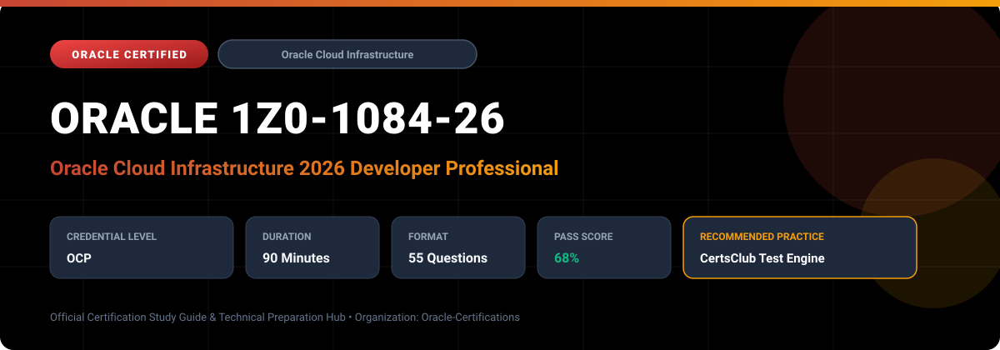

  

# Oracle 1Z0-1084-26: Oracle Cloud Infrastructure 2026 Developer Professional

---

## 1. Exam Overview & Candidate Profile

The **Oracle 1Z0-1084-26: Oracle Cloud Infrastructure 2026 Developer Professional** examination is engineered for enterprise architects, solution specialists, functional consultants, and implementation professionals seeking formal industry recognition of their proficiency in Oracle technologies.

The Oracle Cloud Infrastructure 2026 Developer Professional (1Z0-1084-26) certification confirms your capability to design, implement, and deploy cloud-native applications on Oracle Cloud Infrastructure (OCI). The exam validates proficiency in serverless computing with OCI Functions, container orchestration with OCI Container Engine for Kubernetes (OKE), automated deployments via OCI DevOps service, API security via OCI API Gateway, and Infrastructure as Code with Terraform and Resource Manager.

### Target Audience & Prerequisites
- **Target Roles**: Implementation Specialists, Cloud Architects, Technical Leads, Enterprise Functional Consultants, and Systems Engineers.
- **Recommended Experience**: 1–2 years of practical, hands-on experience designing, implementing, and maintaining corresponding Oracle Cloud solutions.
- **Credential Earned**: Oracle Certified Professional (OCP).

---

## 2. Key Exam Specifications

| Specification | Details |
| :--- | :--- |
| **Exam Code** | **Oracle 1Z0-1084-26** |
| **Official Title** | Oracle Cloud Infrastructure 2026 Developer Professional |
| **Certification Track** | Oracle Cloud Infrastructure |
| **Exam Duration** | 90 Minutes |
| **Number of Questions** | 55 Questions |
| **Passing Score** | 68% |
| **Question Format** | Multiple Choice (Single/Multiple Answer), Scenario-Based Questions |
| **Delivery Provider** | Oracle University / Pearson VUE (Online Proctored or Test Center) |
| **Recommended Practice Engine** | [CertsClub Oracle Practice Tests](https://www.certsclub.com/oracle/1z0-1084-26-dumps.html) |

---

## 3. Official Blueprint & Exam Domain Breakdown

The examination assesses candidate competencies across core functional domains weighted as follows:

| Domain Area | Weighting |
| :--- | :--- |
| **Cloud-Native Architecture & Microservices Patterns** | `20%` |
| **OCI Functions & Serverless Application Development** | `25%` |
| **Container Engine for Kubernetes (OKE) & OCI Registry (OCIR)** | `20%` |
| **DevOps CI/CD Pipelines & Infrastructure as Code (Resource Manager)** | `20%` |
| **API Gateway, Streaming, Events & Security Integration** | `15%` |

---

## 4. Deep Dive into Complex & Challenging Technical Topics

To secure a passing score on the 1Z0-1084-26 exam, candidates must master the following advanced concepts:

- Building serverless event-driven microservices using OCI Functions and the Fn Project with custom container runtimes.
- Deploying and managing production Kubernetes clusters on OKE with cluster autoscalers, ingress controllers, and pod security standards.
- Designing automated CI/CD workflows using OCI DevOps build stages, deployment pipelines to OKE/Compute, and approval gates.
- Securing microservice endpoints using OCI API Gateway with OAuth2, JWT validation, rate limiting, and mutual TLS (mTLS).

---

## 5. Scenario-Based Demo & Practice Questions

### Question 1
A cloud engineer wants to trigger an OCI Function automatically whenever a new object is uploaded to a specific private bucket in OCI Object Storage. What configuration achieves this with minimal latency and operational overhead?

A) Write a polling cron script on an OCI Compute instance to check bucket contents every minute.
B) Enable Object Events on the bucket and configure an OCI Events Service rule with the Function as the action target.
C) Expose the function via API Gateway and configure Object Storage Webhooks.
D) Use OCI Data Integration to stream object events.

- **Correct Answer**: `B) Enable Object Events on the bucket and configure an OCI Events Service rule with the Function as the action target.`  
- **Technical Explanation**: Enabling Emit Object Events on the Object Storage bucket allows OCI Events Service to capture 'Object - Create' events and trigger the targeted OCI Function directly in a serverless, decoupled architecture.

---

### Question 2
Which OCI service is designed to manage containerized application deployments, automate canary and blue/green release strategies, and integrate natively with OCI Container Engine for Kubernetes (OKE)?

A) OCI Resource Manager
B) OCI DevOps Service
C) OCI Registry (OCIR)
D) OCI Cloud Guard

- **Correct Answer**: `B) OCI DevOps Service`  
- **Technical Explanation**: OCI DevOps is a fully managed continuous integration and continuous deployment (CI/CD) service that supports blue/green and canary deployment strategies to OKE and Compute instances.

---

## 6. Recommended Preparation Strategy & Practice Testing Engine

Achieving certification in **Oracle 1Z0-1084-26** requires balanced theoretical study and scenario-based simulation practice:

1. **Review Oracle Documentation**: Master architecture guides, implementation workbooks, and administration manuals on the Oracle Help Center.
2. **Hands-on Lab Practice**: Execute real-world configuration, policy setup, and troubleshooting tasks in your cloud tenancy or test instance.
3. **Simulated Exam Drills**: Practice answering timed, scenario-based multiple-choice questions to familiarize yourself with the question formats, traps, and timing constraints.

### Practice With CertsClub
For realistic practice questions, updated dumps, and mock testing environments:
- **Resource**: [CertsClub Oracle Practice Test Engine](https://www.certsclub.com/oracle/1z0-1084-26-dumps.html)
- **Special Discount**: Use coupon code **`club20`** during checkout for an instant **20% discount** on all practice exam bundles and testing engines.

---

## 7. Official Documentation & References

- [Oracle University Certification Registry](https://education.oracle.com/)
- [Oracle Help Center Documentation Portal](https://docs.oracle.com/)
- [Oracle Cloud Infrastructure & Applications Guides](https://docs.oracle.com/en/cloud/)
- [CertsClub Oracle Certification Exam Practice](https://www.certsclub.com/oracle/1z0-1084-26-dumps.html)

---

## 8. SEO & Discovery Keywords

`oracle 1z0-1084-26, oracle 1z0-1084-26 exam, oracle 1z0-1084-26 dumps, 1Z0-1084-26 practice questions, 1Z0-1084-26 study guide, oracle 1z0-1084-26 syllabus, oracle cloud infrastructure 2026 developer professional, certsclub 1z0-1084-26`
